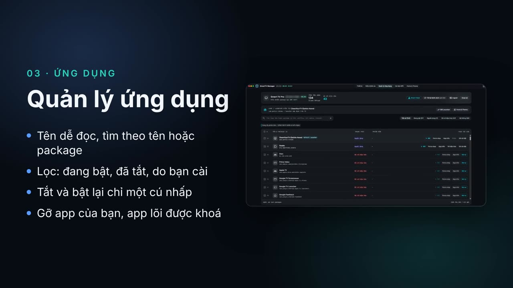

# SmartTV Manager

Desktop app (Python + pywebview) để quản lý TV từ máy tính: quét LAN, remote, quản lý app, cài APK, theme Home (Gathin launcher) và, từ bản 1.10.0, cả TV LG webOS.

## Thiết bị hỗ trợ

| Nền tảng | Cổng | Tính năng | Mức kiểm chứng |
|----------|------|-----------|----------------|
| **Android TV / Google TV** | ADB 5555 | Remote, quản lý/gỡ app, cài APK, Smart Clean, TV Guard, theme Home (Gathin launcher) | Thử trên TCL Google TV (Android 11); máy khác dùng ADB chuẩn nên nhiều khả năng chạy |
| **LG webOS** (từ 1.10.0) | 3001 (TLS), 3000 (TV đời cũ) | Remote, nhập văn bản, mở app, chuyển HDMI, tắt nguồn, Home theme/widget dạng snapshot | **Chưa kiểm chứng trên TV LG thật** — coi là bản thử nghiệm |

LG **không** hỗ trợ: APK, Smart Clean, Android shell/screenshot ADB, TV Guard, đổi launcher mặc định.

### Lưu ý khi dùng bản 1.10.0

- **Quét mạng** dò một lượt cả 5555 (Android) và 3001/3000 (LG). Loại TV chỉ là gợi ý theo cổng mở; thiết bị mở cả hai nhóm cổng sẽ cho bạn chọn nền tảng. TV dùng cổng khác: nhập `IP:cổng` và chọn nền tảng thủ công.
- **LG ghép cặp:** lần đầu phải chấp nhận yêu cầu trên TV (bật LG Connect Apps nếu không thấy). Sau cập nhật firmware TV mà không kết nối được, bấm **Quên ghép cặp** rồi ghép lại.
- **LG Home theme** cần Developer Mode trên TV, Node.js 20+ và `npm install -g @webos-tools/cli`; profile CLI phải dùng **địa chỉ IP** đúng TV đang chọn. Mỗi lần Apply là một snapshot, muốn cập nhật dữ liệu thì Apply lại. Developer Mode hết hạn thì app có thể bị LG gỡ. Chi tiết: [hướng dẫn LG](docs/lg-webos.md).
- **Android:** lần đầu vẫn cần chấp nhận «Allow USB debugging» trên TV.
- **Windows:** nếu thấy `Failed to resolve Python.Runtime.Loader.Initialize`, xem mục build bên dưới (app tự gỡ chặn file tải về từ 1.10.0).

ADB key riêng tại `~/.smarttv-manager/adbkey` — **không** dùng chung với CLI `cleanyourtv`. Nếu bạn đã dùng bản cũ, dữ liệu từ `~/.tv-remote-hub/` được **copy sang** `~/.smarttv-manager/` lần chạy đầu.

---

## Video giới thiệu

[](https://nvt-ak.github.io/smart-tv-manager/assets/video/smarttv-manager-intro-vi.mp4)

Bấm vào ảnh để xem video 45 giây (tiếng Việt). [English version](https://nvt-ak.github.io/smart-tv-manager/assets/video/smarttv-manager-intro-en.mp4) · [Trang giới thiệu](https://nvt-ak.github.io/smart-tv-manager/).

---

## Nguồn & mã tham chiếu từ [cleanyourtv](https://github.com/Gathin23/cleanyourtv)

SmartTV Manager **không phải** fork nguyên repo cleanyourtv, nhưng **có sử dụng và dựa trên** tài nguyên / luồng xử lý từ dự án đó:

| Thành phần | Trong repo này | Ghi chú |
|------------|----------------|---------|
| **Bộ theme mẫu** | [`data/cleanyourtv/themes/`](data/cleanyourtv/themes/) | Theme JSON/wallpaper copy từ repo cleanyourtv (xem [`data/cleanyourtv/themes/README.md`](data/cleanyourtv/themes/README.md)). |
| **Load theme gallery** | [`core/cleanyourtv_themes.py`](core/cleanyourtv_themes.py) | Đọc theme local theo cấu trúc cleanyourtv. |
| **Apply / backup theme lên TV** | [`core/theme_manager.py`](core/theme_manager.py) | Cách push qua `content://com.gathin.tvhome.theme`, backup, restart launcher — **tham chiếu** `tools/theme.sh` và tài liệu theme trong cleanyourtv. |
| **Phát hiện launcher** | [`core/launcher_detector.py`](core/launcher_detector.py) | Hướng tới `com.gathin.tvhome` như cleanyourtv. |

Khi cập nhật theme hoặc logic overlay, nên đối chiếu upstream:  
**https://github.com/Gathin23/cleanyourtv**

Tuân thủ license của cleanyourtv khi copy/redistribute theme hoặc đoạn logic tương ứng (xem file `LICENSE` trên repo upstream).

---

## Cài đặt & chạy dev

```bash
python3.11 -m venv venv   # 3.10.8+ OK; tránh 3.10.0–3.10.7 khi build PyInstaller
venv/bin/pip install -r requirements.txt
venv/bin/python main.py    # mở splash → UI chính
```

Dữ liệu người dùng: `~/.smarttv-manager/` (macOS/Linux) hoặc `%USERPROFILE%\.smarttv-manager\` (Windows) — `devices.json`, `adbkey`, log apply theme, v.v.

---

## Build bản cài (macOS + Windows)

**PyInstaller không cross-compile:** trên Mac **không** ra được `.exe` Windows (và ngược lại). pywebview gắn WebView2 (Windows) / WebKit (macOS) — phải build **trên đúng OS**.

### Build thủ công (local)

| OS | Lệnh | Output |
|----|------|--------|
| **macOS** | `./scripts/build_macos.sh` | `dist/SmartTV Manager.app` |
| **Windows** | `.\scripts\build_windows.ps1` | `dist\SmartTVManager\` (thư mục, chạy `SmartTVManager.exe`) |

Cả hai script cài `requirements.txt` + `requirements-build.txt` rồi gọi PyInstaller với spec tương ứng (`tv_remote_hub_mac.spec` / `tv_remote_hub.spec`).

**Người dùng Windows:** cần [WebView2 Runtime](https://developer.microsoft.com/en-us/microsoft-edge/webview2/) (Win 10/11 thường đã có). Nếu gặp `Failed to resolve Python.Runtime.Loader.Initialize`: app đã tự gỡ chặn file tải về; nếu vẫn lỗi, chuột phải file zip → Properties → Unblock rồi giải nén lại vào đường dẫn ngắn (vd `C:\Tools\`), kiểm tra Windows Security có cách ly `Python.Runtime.dll`, và gửi `%LOCALAPPDATA%\SmartTVManager\startup-error.log`.

**macOS bản unsigned:** lần mở đầu có thể **Right-click → Open**.

### Build & publish tự động (GitHub Actions)

Workflow: [`.github/workflows/build-release.yml`](.github/workflows/build-release.yml)

| Kích hoạt | Build | Publish |
|-----------|--------|---------|
| **Push tag** `v*` (vd. `v1.0.1`) | macOS **`.dmg`** + Windows **`.zip`** (chứa `SmartTVManager.exe`) | **GitHub Release** tự tạo, đính kèm 2 file |
| **Actions → Run workflow** (không tag) | Cùng 2 artifact trên tab **Actions** | **Không** tạo Release (chỉ để test build) |

**Publish lên GitHub (một lệnh sau khi commit):**

1. Cập nhật [`CHANGELOG.md`](CHANGELOG.md) (đóng section `[Unreleased]` → `[x.y.z] - ngày` trước khi tag).
2. Tag và push:

```bash
git tag v1.0.1
git push origin v1.0.1
```

Đợi workflow xong → mục **Releases** trên repo có bản tương ứng tag, ví dụ `v1.0.0` với:

- `SmartTVManager-macos.dmg`
- `SmartTVManager-windows-x64.zip` (giải nén → `SmartTVManager.exe`)

Artifact trên Actions vẫn giữ **30 ngày** (tải lại nếu cần).

**Lưu ý:** Windows là **zip portable** (PyInstaller one-folder), không phải installer `.exe` NSIS/Inno. macOS DMG **unsigned** — người dùng có thể cần Right-click → Open.

---

## Ghi chú vận hành

- Thiết bị đã lưu: `~/.smarttv-manager/devices.json`.
- Quét LAN chỉ kiểm tra port mở; **không** authenticate ADB cho đến khi bạn bấm Kết nối — quét một mình không hiện popup TV.
- Theme: cần TV dùng launcher tương thích (Gathin / cleanyourtv); bật USB debugging và cùng Wi‑Fi với máy tính.
