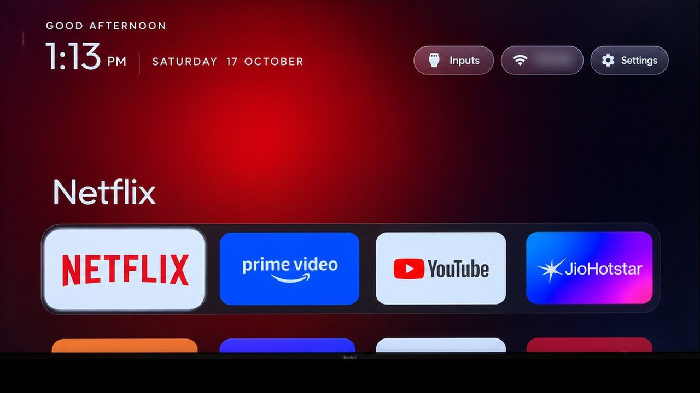
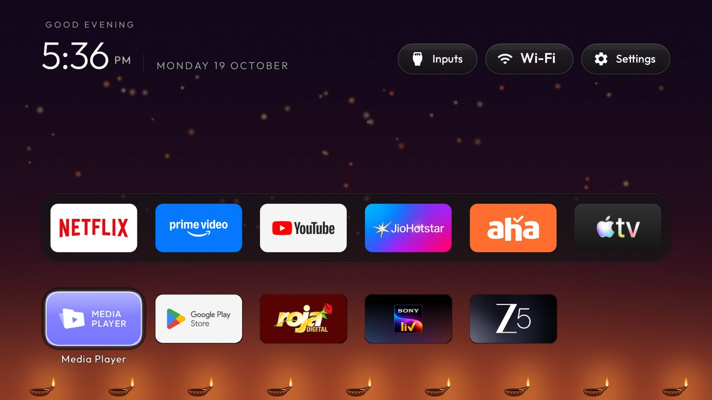
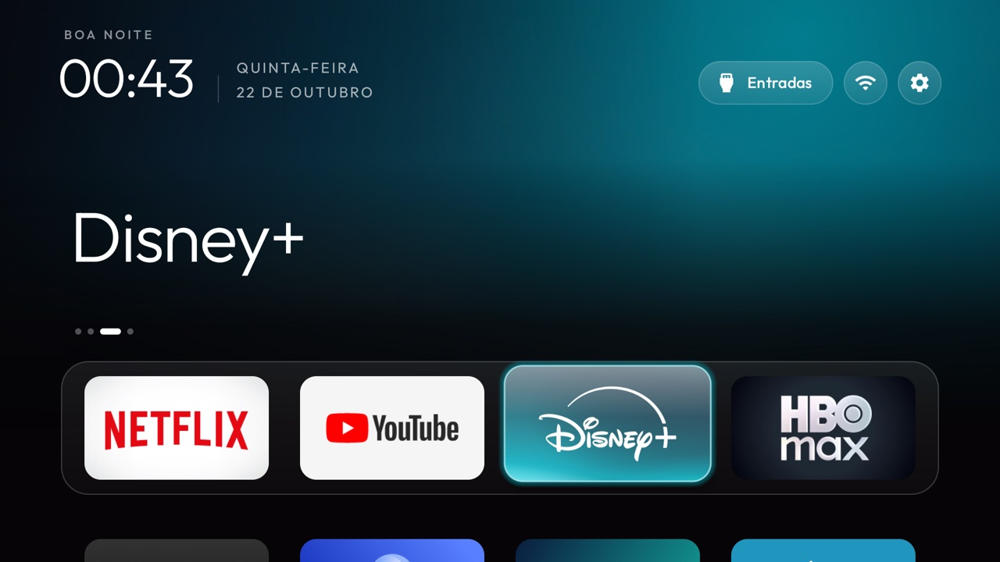
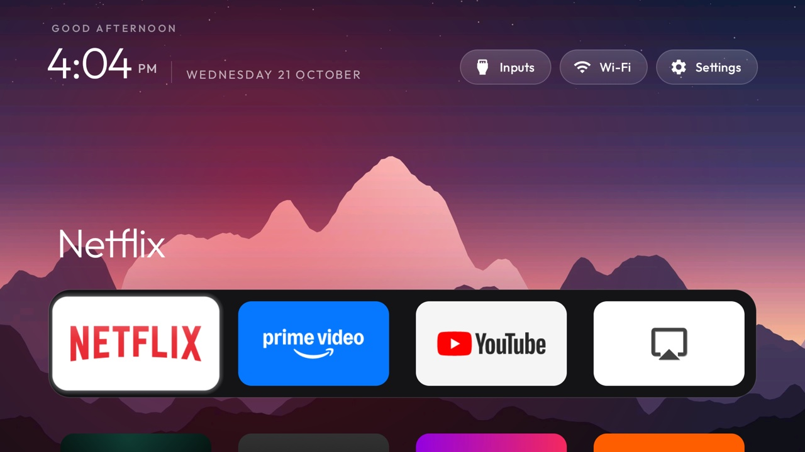

# Themes

A theme is a folder with a `config.json` and, optionally, a `wallpaper.jpg`. Pushing one changes the
launcher's dock, layout and look on the TV without rebuilding the APK: the launcher reads
`config.json` as an overlay over its built-in `config.xml` the next time it starts.
Choices made in Launcher settings take priority until you choose Follow theme. Pushing a theme or
using `tools/theme.sh --reset` also clears those on-TV column and motion choices.

```bash
TV_HOST=192.168.1.50 tools/theme.sh themes/aurora          # push a theme and restart Home
TV_HOST=192.168.1.50 tools/theme.sh --reset                # back to the built-in config.xml
powershell -ExecutionPolicy Bypass -File tools\theme.ps1 -TvHost 192.168.1.50 themes\aurora
```

| Theme | What it does | Screenshot |
|---|---|---|
| `default/` | The built-in look written out as JSON, as a starting point for your own |  |
| `aurora/` | A dark aurora wallpaper (teal and violet on navy, darker at the bottom) with a matching background colour |  |
| `dussehra/` | Festive skin for Dussehra (ends 21 Oct 2026): a marigold toran, a faint gold rangoli, a diya for Wi-Fi, a bell for Inputs, a marigold for Settings and a petal shower |  |
| `glass/` | Dark navy wallpaper with soft teal and violet light, the cinematic top shelf, a frosted-glass dock, icon-only buttons and the focus glow in the app's colour, gliding without overshoot |  |
| `scenes/` | 14 dark illustrated landscapes in `wallpapers/`, a new one every hour; drawn from code by `tools/scenes_wallpapers.py` |  |
| `six-columns/` | Six smaller tiles per row and one grid row visible under the dock |  |

Every theme folder has a `screenshot.jpg` of Home with that theme on a real TV. `tools/theme.sh` never
pushes it; it is only here so you can see a theme before you try it.

## Keys

Every key is optional; a missing key keeps the value from `config.xml`, an unknown or wrongly typed key
is ignored, and a file that doesn't parse is ignored as a whole, so a theme can never break Home.

| Key | Type | Meaning |
|---|---|---|
| `dock_apps` | list of package names | The dock row, in order; missing apps are skipped |
| `fill_dock` | bool | Fill the dock slots `dock_apps` leaves free with the first grid apps (true by default); false leaves them empty |
| `hidden_apps` | list of package names | Never shown as tiles |
| `live_tv_package`, `live_tv_action` | string | The Live TV app and, if it has no leanback entry, the action to start it with |
| `live_tv_input_id` | string | Exact system tuner for the Inputs menu's Live TV row; opens its channel collection. Empty keeps automatic selection. Missing input or unsupported collection falls back to the app's normal launch. [HAAM satellite example](../docs/devices/haam-r4.md) |
| `source_panel_service`, `source_panel_action` | string | The TV's own source panel, for sets with no TvInputManager: a service, or an activity (BYINTEK U4). Without a Live TV app, the Inputs pill opens it directly |
| `source_panel_extra` | `"name=value"` | One int extra sent with the source panel (Coocaa OS: `control_center_command=100`) |
| `coocaa_sources` | bool | Coocaa OS (Skyworth, China): list the sources from `com.skyworth.tv` in the Inputs menu, ahead of the source panel |
| `launch_actions` | list of `"package=action"` | Tiles that open a screen of the app instead of its start screen; an action that no longer resolves opens the app normally (MagentaTV's guide: `com.telekom.onetv.tv.pl=com.telekom.onetv.tv.pl.action.PROGRAM_GUIDE`) |
| `app_labels` | list of `"package=Name"` | A tile's name instead of the app's own (MagentaTV as `com.telekom.onetv.tv.pl=TV`) |
| `app_banners` | list of `"package=banner_name"` | A tile's artwork from a `banner_*` drawable bundled with the launcher (`banner_tv`: magenta with the Live TV glyph) |
| `input_action` | string | Action sent with an HDMI/AV row's channel URI when nothing handles the standard `VIEW` (XGIMI: `com.xgimi.action.hdmiPlayer`). Only a handler-less set gets here; any app that claims the channel MIME type takes the row instead, so check with `query-activities` ([#805](https://github.com/Gathin23/cleanyourtv/issues/805)) |
| `input_uri_scheme` | string | Scheme an HDMI/AV row's passthrough URI is sent with instead of `content://`, with no MIME type (YaOS: `live-tv`, which its source player answers) |
| `input_sources` | list, `config.xml` only | Vendor source numbers for the Inputs menu, `HW<n>=<number>` by the input id's last part; a mapped input opens by sending `input_action` with the number as the int extra `input`, and `HW<n>=-` leaves a port the set doesn't have out of the menu. Xiaomi/Redmi China firmware: [redmi-mitv-mftp0](../examples/redmi-mitv-mftp0/). Not read from a theme |
| `columns` | 1 to 8 | Tiles per row; tiles shrink to fit from 5 up |
| `rows_below_dock` | 0 to 3 | Grid rows left visible under the dock; tiles shrink if the dock, its title and that many rows would not fit the screen height |
| `dock_title` | bool | The focused dock app's name in large type above the dock (`true`); `false` keeps only the glow |
| `dock_row` | bool | The dock as its own row with a band (`true`); `false` makes the dock apps the first tiles of one plain grid |
| `reorder_button` | bool | A reorder button in the top bar (`false` by default); reordering is always in the Settings button's long-press menu |
| `show_network_pill` | bool | The Wi-Fi/Ethernet pill in the top bar (`true` by default); `false` hides it |
| `show_inputs_pill` | bool | The Inputs pill in the top bar, shown when the TV has inputs (`true` by default); `false` hides it; what the remote's Input button does is unchanged |
| `icon_only_buttons` | bool | Wi-Fi and Settings as round icon buttons; Inputs keeps its label (`false` by default) |
| `top_menu` | bool | Inputs, Wi-Fi and Settings folded into one round gear, centred on the header: OK drops a menu with the three, hold OK keeps the launcher menu (`false` by default) |
| `launcher_settings_button` | bool | Make the header Settings action open Launcher settings directly with a matching 22dp home icon; also changes the Settings row when `top_menu` is on. Hold OK keeps module-card and ordering tools. The settings page includes Reorder apps and TV settings (`false` by default) |
| `wifi_label_width` | 0 to 300 | With `icon_only_buttons`, keep the network name on the Wi-Fi pill up to this width in dp, cut with an ellipsis; 0 leaves only the icon |
| `library_button` | bool | The app library as a round button in the top bar, beside Settings; needs `app_library`. Closing the library returns to it |
| `always_show_names` | bool | Names under every tile, dimmed until focused, the dock included (its band grows to hold them); `false` by default shows only the focused tile's name |
| `wallpaper_true_color` | bool | Decode wallpapers in 32-bit colour (8 MB at 1080p) instead of RGB_565 (4 MB), which bands dark gradients such as a night sky; for TVs with 2 GB or more (`false` by default) |
| `app_library` | bool | An App library pill after the last Home row: every installed app, add one to Home or take it off (`false` by default). The choices stay on the TV when a theme is pushed or reset; see [docs/app-library.md](../docs/app-library.md) |
| `shamsi_date` | bool | Show the Solar Hijri date above the Gregorian one |
| `greeting_name` | string | A name after the greeting, e.g. `"Mr. Trịnh"` for GOOD MORNING, MR. TRỊNH; empty for the greeting alone |
| `module_cards` | bool | Look for module cards and ask about them (`true`); `false` turns the feature off |
| `reduced_motion` | bool | Calmer motion for weak GPUs: highlight settles in 5 frames, animations 90 ms or less, no fades, no tile entrance |
| `reduced_motion` | bool | Calmer motion for weak GPUs: stiff highlight spring, no tile overshoot, short fades, no entrance replay |
| `boot_to_live_tv` | bool | Open the Live TV app (`live_tv_package`) on the first Home after the TV starts, once per boot |
| `focus_overshoot` | bool | The highlight and the focused tile swing past their target before settling (`true` by default); `false` glides straight there with smooth scrolling |
| `vpn_app` | string | App the network pill opens when a VPN is configured; also shows a red "VPN off" badge while no VPN is up |
| `animations` | bool | Basic focus, glass, title and tile entrance motion; true by default |
| `advanced_effects` | bool | Optional lifted tile, icon zoom, smooth ambient colour and app opening effects; false by default |
| `show_home_settings_shortcut` | bool | Keep the optional Default-home tile visible when the TV has a home picker; false by default |
| `show_stats` | bool | One line under the clock with CPU, free memory and free storage. Off unless set |
| `handle_view_inputs` | bool | Answer the system input switcher (`VIEW_INPUTS`, what the remote's Input button becomes) with the Inputs menu, for sets whose stock launcher was its only handler (Hisense huangshan); `false` by default so a TV with its own input picker never gets a chooser |
| `background_color` | `#RRGGBB` | Colour behind everything; black by default |
| `sky_intensity` | 0 to 100 | Time-of-day backdrop: a dark gradient that follows the clock, 0 hides it (default) |
| `wallpaper` | bool | Show `wallpaper.jpg` from the theme folder (`true`), or ignore it (`false`) |
| `wallpaper_rotation_minutes` | 0 to 1440 | Rotate images in the theme's `wallpapers/` folder at this interval; 0 keeps the single-image behaviour. A negative or non-numeric value is ignored, and 0 means "no rotation", not "every minute" |
| `wallpaper_rotation_seconds` | 0 to 3600 | Rotate images in the theme's `wallpapers/` folder every this many seconds. It wins over `wallpaper_rotation_minutes`, so 10 changes the picture every 10 seconds; 0 keeps the minutes behaviour. Off by default |
| `wallpaper_order` | `shuffle` or `sequential` | How a collection advances. `shuffle` (the default, and what launchers did before this key existed) avoids repeating the current picture; `sequential` walks the folder in filename order and wraps at the end. An unknown value falls back to `shuffle` |
| `wallpaper_dim` | 0 to 90 | Black overlay over wallpaper images, in percent; 0 by default and no shade view at all |
| `dock_opacity` | 30 to 100 | Opacity of the dock's band, in percent, so a wallpaper shows through it; 100 by default (the cinematic shelf keeps its own translucent band). Launcher settings on the TV offers 100, 70, 50 or 30, which wins until the next theme push or Follow theme |
| `wallpaper_captions` | bool | With a rotating collection, the shown picture's name under the top-right buttons, from `wallpapers/captions.txt` (`001.jpg<TAB>Dusk over the peaks`, one per line); a picture without a line shows no name (`false` by default) |
| `tile_menu` | bool | Hold OK on a tile opens a small menu: Move, Remove from Home (with `app_library`) and App info. `false` (the default) keeps holding OK as a shortcut to the app's App info page |
| `festival` | string | Turns on a festive skin: the network pill becomes a diya whose flame follows the connection, Inputs a temple bell, Settings a marigold, and the first Home of the day gets a petal shower. `dussehra` and `diwali` have built-in greetings |
| `festival_until` | `YYYY-MM-DD` | Last day the festive skin shows; it switches itself off after that. A malformed date turns it off |
| `greeting` | string | Replaces the time-of-day greeting while the festive skin is on |
| `accent_color` | `#RRGGBB` | Colour of the focus glow while the festive skin is on; diya gold if not set |
| `settings_key_keycodes` | list of keycodes | Remote buttons that open Settings, for `HomeKeyService` (TCL Google TV gear: `[83]`) |
| `settings_key_panel` | bool | Those buttons open a small quick settings panel (TV settings, Display, Network, Apps, Launcher settings) instead of the TV's Settings |
| `restore_key_services` | bool | After a force stop of the launcher, Home puts the remote's accessibility helpers (`HomeKeyService`, `InputKeyService`) back on the enabled list; needs `RESTORE_KEY_SERVICES=1` at install. Off by default |
| `input_key_keycodes` | list of keycodes | More remote buttons that open the input switcher, for `InputKeyService` (`KEYCODE_TV` and `KEYCODE_TV_INPUT` always do) |
| `app_keys` | list of strings | Remote buttons that open an app, as `"190:com.google.android.youtube.tv"` or `"KEYCODE_BUTTON_3:com.google.android.youtube.tv"`, or by scancode as `"scan:490:com.wbd.hbomax"` for remotes that share one keycode between app buttons (Sony BRAVIA), for `InputKeyService` or `HomeKeyService` |
| `key_filter` | bool | `false` makes the key helpers stop filtering keys while staying enabled. Use it on firmware where any key-filtering accessibility service breaks long-press repeat (TCL Google TV on Android 12): the remote buttons above stop working, and volume repeat comes back |
| `app_keys` | list of strings | Remote buttons that open an app, as `"190:com.google.android.youtube.tv"` or `"KEYCODE_BUTTON_3:com.google.android.youtube.tv"`, or by scancode as `"scan:490:com.wbd.hbomax"` for remotes that share one keycode between app buttons (Sony BRAVIA), for `InputKeyService` or `HomeKeyService`. `"input:<input id>"` in place of the package switches to a TV input instead, e.g. `"scan:227:input:com.tcl.tvinput/.passthroughinput.TvPassThroughService/HW1413744640"` for an HDMI port (ids from `dumpsys tv_input`) |
| `app_keys` | list of strings | Remote buttons that open an app, as `"190:com.google.android.youtube.tv"` or `"KEYCODE_BUTTON_3:com.google.android.youtube.tv"`, for `InputKeyService` or `HomeKeyService` |
| `stock_home_redirect` | string | Stock launcher package; if the firmware turns it back on (XGIMI), its home screen is sent straight back here (`HOME_KEY_SERVICE=1`) |
| `app_keys` | list of strings | Remote buttons that open an app, as `"190:com.google.android.youtube.tv"` or `"KEYCODE_BUTTON_3:com.google.android.youtube.tv"`, or by scancode as `"scan:490:com.wbd.hbomax"` for remotes that share one keycode between app buttons (Sony BRAVIA), for `InputKeyService` or `HomeKeyService`. Prefix an entry with `hold:` to open a second app on a long press, e.g. `"hold:190:com.netflix.ninja"` |
| `race_calendar` | list of races | F1 race-weekend mode: from 12 hours before a weekend's first session until 4 hours after the race starts, a panel under the clock shows the next session with a countdown (or the live one) and the weekend's session times in the TV's time zone. Write it with `tools/race_calendar.py <theme folder>`, which fetches the season from the free Jolpica API; the launcher itself never goes online |
| `home_idle_clock_minutes` | 0 to 1440 | Minutes Home may sit untouched before it shows the clock screensaver (a thin clock and date drifting over a slow glow, as the system "Clock" screensaver does). Any key returns to Home. It starts only from Home, never over Live TV or an app; 0 is off (default) |
| `glow_style` | string | Shape of the glow behind the focused app, in its colour: `radial` (default) or `horizon`, the colour washing down from the top edge to black; the cinematic shelf keeps its own |
| `cinematic_home` | bool | Cinematic top shelf: the focused dock app's artwork, softened, fills the top of the screen in its colour, with a larger name, "Last opened" (apps opened from Home), dock position dots, a focus glow in the app's colour and a translucent dock band; off by default |
| `dock_glass` | bool | The dock band as light frosted glass like the top bar's pills (`false` by default); suits `sky_intensity` or a wallpaper, where the solid band reads as a dark slab |
| `ambient_glow` | bool | The glow behind the dock in the focused app's colour (`true` by default); `false` keeps only `background_color` or the wallpaper, e.g. for a calm photo background |
| `app_glow` | bool | The focus highlight glows in the focused app's colour on every tile, as `cinematic_home` does for the dock (`false` by default) |

## Wallpapers

`wallpaper.jpg` is drawn full screen behind the launcher, centre-cropped. Keep it dark, 1920×1080 and
under about 300 KB: the text, the hero name and the dock band are designed for black, and a 1 GB TV
decodes the picture into memory on every Home start. Pictures larger than the screen are scaled down to
it; a picture that is still over 4K (about 8.4 million pixels) after it is sampled down to the screen is not shown at all, and the plain colour stays.

For a wallpaper collection, place JPEG, PNG or WebP files in the theme’s `wallpapers/` folder beside `config.json`, then set:

```json
{ "wallpaper": true, "wallpaper_rotation_minutes": 30, "wallpaper_dim": 40, "wallpaper_order": "sequential" }
```

The last displayed picture is remembered on the TV, so a restart or reboot resumes from it rather than
starting over at the first image in `sequential` mode. Missing an interval while the TV is asleep or
unplugged does not replay the missed pictures: Home moves on at most once when it wakes. Replacing the
collection starts playback from the new collection's first picture. A collection with one picture is
shown once and never blanked on a timer. Images are centre-cropped to fill the 16:9 screen; dimming is
drawn as a black overlay above the picture and below the launcher's text.

When you apply a theme, its collection replaces the one already on the TV. Use filenames containing
only letters, digits, underscores, dots and hyphens. Images can come from any source; check that you
have permission to use them. The launcher considers
up to 100 nonempty images, at most 10 MB each, skips unreadable files and keeps the last good background.
An empty collection falls back to `wallpaper.jpg`, or the background colour if no image is available.
`"wallpaper": false` disables both single-image and collection backgrounds.

Selection is random without an immediate repeat when alternatives exist. The current image and its
change time survive app/process restarts. Rotation runs only while Home is visible; on return from
another app, an overdue background changes then. Images are decoded on a worker thread and bounded
to the screen size. There is no download service, Internet permission or computer-side scheduler.
The original system idle screensaver is left unchanged.

On the TV, Launcher settings has a Wallpaper row: pick one picture from the collection (or the theme's
`wallpaper.jpg`), or None. A pick shows that one picture and stops the rotation until you choose Theme
default, press Follow theme, or push a theme again.

## Reduced motion

`"reduced_motion": true` keeps the look but calms the movement and draws far fewer frames: the
highlight slides without bouncing and settles within 5 frames, every animation (tile zoom, dropdowns,
the app library) lasts 90 ms or less, names, the top shelf, the glow and the highlight appear instead of
fading, and there is no tile entrance. Use it on TVs whose GPU cannot keep up; a MediaTek MT5895 on
Android 10 is the known case. The default, `false`, keeps the normal motion.

```json
{ "reduced_motion": true }
```

## Time-of-day backdrop

`"sky_intensity": 60` draws a dark gradient over the wallpaper and behind everything else, that follows the
clock: night blues, a soft blue day, then a warm horizon that peaks just before eight in the evening.
The glow near the bottom edge travels from left to right with the sun. The colours stay dark so the
white clock, the hero name and the dock band keep their contrast. It is drawn as one 480×270 bitmap
and redrawn once a minute, never animated, so even a 1 GB TV has nothing to keep up with. `0` keeps
the plain background; the default is off (the reference launcher looks exactly as before).

```json
{ "sky_intensity": 60 }
```

## Adding a theme

Open a PR with a new folder here containing:

- `config.json`, the theme itself.
- `screenshot.jpg`, **required**: Home on a real TV with the theme pushed, not a mock-up or an
  emulator. Take it with `tools/tv.py 'screencap -p /sdcard/s.png'` and
  `tools/tv.py --pull /sdcard/s.png s.png`, then save it as a JPEG at 1280×720 (16:9) under 300 KB,
  for example `sips -z 720 1280 -s format jpeg s.png --out screenshot.jpg` on macOS. Leave the focus on
  the dock so the glow and the hero name show. A PR without it fails CI (`tests/test_themes.py`).
- `wallpaper.jpg` or `wallpapers/` if the theme uses them.

Then add a row to the table above with the screenshot, the same way as the others. Keep the dock list
generic (the big streaming apps) unless the theme is for a specific TV, and say which TV you tried it on
in the PR description.
